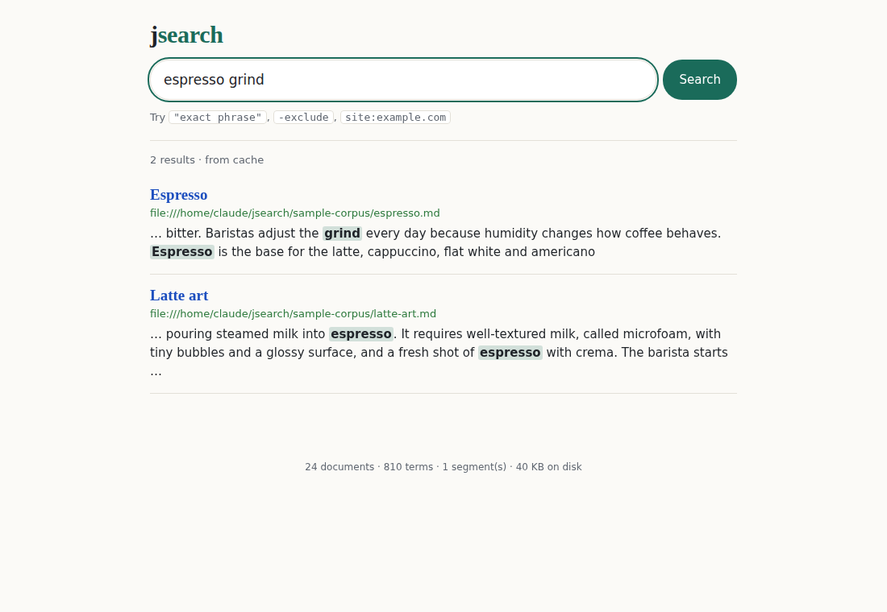

# jsearch


jsearch is a private search engine written from scratch in Java with no dependencies. It crawls websites politely or indexes folders on your computer, builds an on-disk **inverted index**, ranks results with **BM25**, and serves them through a web UI that runs only on your machine.



## Features

- **Crawler:**
  - concurrent (thread pool), with robots.txt including `Allow`, wildcards and `Crawl-delay`;
  - per-host politeness delay, `<meta name="robots">` and `rel=nofollow`;
  - redirect handling, URL normalisation, and staying on the seed sites by default.
- **Local files:** indexes `.md`, `.txt` and `.html` folders. This is the "private" part.
- **Text analysis:**
  - Unicode normalisation (accents removed) and stop words;
  - a **Porter stemmer** written from the original paper, so "connections" matches "connected";
  - word positions kept for phrase search.
- **Index:**
  - immutable segments: sorted term dictionary plus delta- and varint-compressed postings with positions;
  - memory-mapped postings;
  - **k-way segment merging**;
  - URL replacement with delete markers, and an atomic manifest switch.
- **Near-duplicate detection** with **SimHash**: 64-bit fingerprints, Hamming distance ≤ 3.
- **Query language:** `"exact phrases"`, `-exclude`, `site:host`, and free text. Results are paged and snippets are highlighted.
- **Ranking:** BM25 (k1 = 1.2, b = 0.75), with title words weighted 3× and a phrase bonus; top-k uses a min-heap. An LRU cache serves repeated queries.
- **Quality measurement:** precision@5, MRR and nDCG@10 against relevance judgments (`eval`).
- **Web UI and JSON API** (`/api/search`, `/api/stats`), bound to localhost.

## Quick start

```bash
./gradlew build
./gradlew run --args="index-dir ../sample-corpus"          # index the included 25-page corpus
./gradlew run --args="search \"cold brew\" -decaf"
./gradlew run --args="serve --port 8081"                    # open http://localhost:8081
./gradlew run --args="eval ../sample-judgments.tsv"         # P@5, MRR, nDCG@10

# crawl a site (stays on that host, 1 request/second, obeys robots.txt)
./gradlew run --args="crawl https://example.com --max 50 --depth 2"
./gradlew run --args="bench 20000"                         # synthetic performance benchmark
```

(`./gradlew run` executes from the `app/` folder, hence `../sample-corpus`; the index is created in `app/index`.)

## How it works

```
 crawl / index-dir ──▶ Html.parse ──▶ Analyzer (normalise → tokenize → stop words → Porter stem)
                                              │
                                     IndexWriter: buffer ─▶ SegmentWriter ─▶ seg_000001/ (immutable)
                                              │                              seg_000002/ ...
                                              └─ too many segments ─▶ Merger (k-way merge) ─▶ seg_000010/
                                                                          manifest (atomic rename)
 query ──▶ Query.parse ──▶ Searcher: postings ─▶ BM25 ─▶ phrase/exclude/site filters ─▶ top-k heap ─▶ Snippets
```

- [docs/ARCHITECTURE.md](docs/ARCHITECTURE.md): index format, ranking, the crawler.
- [docs/DECISIONS.md](docs/DECISIONS.md): design decisions, including three SimHash mistakes the tests and benchmarks caught.
- [docs/BENCHMARKS.md](docs/BENCHMARKS.md): indexing speed, index size, query latency.

## Testing

`./gradlew test` runs 14 tests:

- **Porter stemmer:** 44 reference word/stem pairs.
- **HTML extraction:** scripts, comments, entities, links and robots meta tags.
- **robots.txt:** precedence and wildcard rules.
- **Search behaviour:** BM25 ordering, phrases including stop-word gaps, exclusion, `site:`, and identical results before and after merging segments.
- **Re-indexing:** replacing a URL removes the old version, even after a merge.
- **Crawler:** runs against a local HTTP server and checks robots.txt, noindex pages, near-duplicates, and the gap between requests.
- **Search quality:** the sample corpus must keep **MRR > 0.9**. It currently scores MRR 0.98 and nDCG@10 0.98 on 27 judged queries.

## Known limitations

- **One field:** title and body are a single field with weighted term frequencies (a BM25F-like shortcut).
- **No spelling correction or synonyms.** Excluded terms use the same stemming as normal terms.
- **Near-duplicate check is O(n):** each new page is compared with every stored fingerprint. Fine for a personal index; web scale would use LSH banding.
- **Crawler memory:** the frontier and seen-set live in memory. There is no JavaScript rendering, so client-side-only sites index poorly.

## What I learned

- **Inverted indexes and compression.** Sorted doc ids allow delta encoding, and varints turn most gaps into one byte.
- **Why log-structured segments work.** Writes never modify old files, merges happen in the background, and one atomic rename publishes a new state.
- **BM25 in practice.** IDF, saturation and length normalisation, plus why "the shorter page wins" is usually right.
- **Measure quality, not only speed.** A judged query set turned "seems better" into numbers.
- **Hashes are not interchangeable.** FNV-1a's high bits are weak for short keys, which broke SimHash until a finalizer mixed them (see DECISIONS.md).

Developed with AI assistance (Claude) as a learning project.
